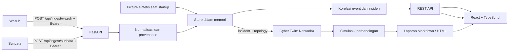
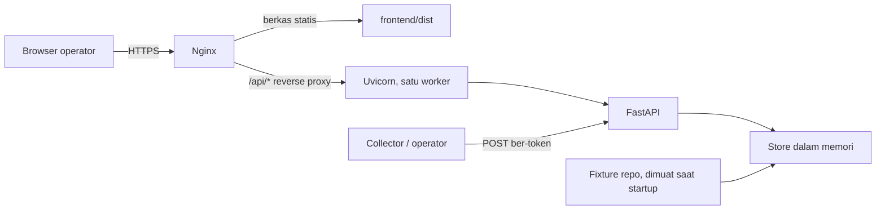

# Arsitektur Dwirupa / COIP

Status: ringkasan untuk submission, berdasarkan source repo dan kondisi deploy yang dibagikan pada 15 November 2026.

## Alur aplikasi

Event mempertahankan rekaman sumber, hash SHA-256, dan identitas parser. Alasan pemetaan aset/IOC serta ID event pada edge dipakai untuk menelusuri dasar korelasi. Event berkeparahan medium ke atas menjadi seed; event yang berbagi aset atau IP eksternal dalam jendela 30 menit dapat dikorelasikan. Event rendah dapat ditambahkan sebagai konteks dalam 15 menit bila menyentuh aset insiden.

## Jalur deploy yang berjalan

Deployment yang dibagikan menggunakan Nginx, Uvicorn, dan HTTPS pada `https://dwirupa.duckdns.org`; Docker tidak dipakai. Backend berjalan sebagai satu proses/worker karena state dibagi melalui memori proses. Restart memuat ulang fixture awal dan menghapus event yang hanya ada di memori. Karena itu, deployment ini adalah demo satu instance, bukan penyimpanan tahan restart atau konfigurasi multi-replica.

## Batas model Cyber Twin

Cyber Twin membandingkan perubahan pada `topology.flows` dan dependensi layanan yang dideklarasikan. Intervensi menghapus alur dari model dan menghasilkan metrik pembatasan, jangkauan, dampak layanan, serta change set advisory. Aplikasi tidak menjalankan perubahan firewall; hasil tidak memvalidasi paket jaringan dan bukan prediksi serangan atau rekomendasi operasional otomatis.

Seluruh fixture yang didokumentasikan berstatus sintetis: 2 site, 8 aset, 10 permitted flows, 3 layanan, 10 alert Wazuh, dan 9 alert Suricata.

## Rujukan repo

- `CONTRACT.md`: data, pipeline, route, model Twin, dan hasil fixture.
- `backend/app/main.py`, `backend/app/store.py`, `backend/app/twin.py`, `backend/app/reports.py`: implementasi API dan logika.
- `frontend/README.md`: lima layar operator dan integrasi.
- `DEPLOYMENT.md`: konfigurasi yang dibutuhkan serta batas state dalam memori.
- Catatan deploy dalam percakapan operator: Nginx melayani UI dan meneruskan `/api`, HTTPS aktif, `GET /api/overview` mengembalikan JSON.
